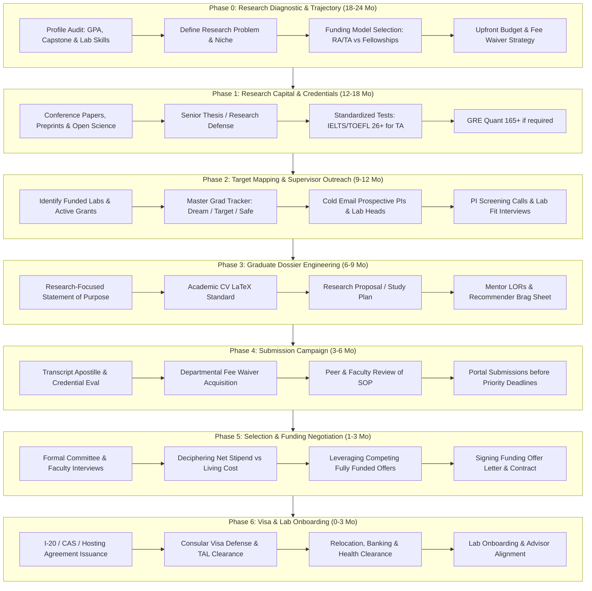

# 🎓 The Fully Funded Masters & PhD Abroad Roadmap
### *The Definitive Blueprint for Securing 100% Funded Postgraduate Degrees, Research Assistantships (RA/TA), and Prestigious Fellowships*

---

## 🌟 Executive Charter & The "Fully Funded" Standard

Securing a funded graduate seat (Master’s or PhD) abroad is not a game of chance—it is an **intellectual hiring process**. Universities, research councils, and national governments do not award funding out of benevolence; they invest capital in high-potential researchers capable of generating publications, winning grants, teaching undergraduates, and driving innovation.

This roadmap is engineered exclusively for **prospective Master’s and Doctoral (PhD) candidates**. It eliminates undergraduate noise, self-funded degrees, and partial tuition discounts, focusing purely on opportunities that meet **The Golden Standard of Full Funding**:

```
┌────────────────────────────────────────────────────────────────────────┐
│                   THE GOLDEN STANDARD OF FULL FUNDING                  │
├────────────────────────────────────────────────────────────────────────┤
│  ✓ 100% Full Tuition Remission / Waiver                                │
│  ✓ Monthly Living Stipend / Salary (covering rent, food & utilities)   │
│  ✓ Comprehensive Health & Accident Insurance                           │
│  ✓ Research / Conference Travel Grants & Bench Fees                    │
│  ✓ Relocation / Return Airfare Allowance (often included in flagships) │
└────────────────────────────────────────────────────────────────────────┘
```

---

## 🗺️ Master Graduate Admissions & Funding Pipeline



---

## 📑 Roadmap Quick-Jump Table

| Phase | Core Milestone | Ideal Timeline | Critical Deliverable |
| :--- | :--- | :--- | :--- |
| **Phase 0** | [Research Diagnostic & Funding Models](#phase-0-research-diagnostic--funding-architecture-1824-months-before) | 18–24 Months Before | Research niche definition & funding route |
| **Phase 1** | [Research Capital & Credentials](#phase-1-research-capital--credentials-elevation-1218-months-before) | 12–18 Months Before | Working preprint/paper, test scores |
| **Phase 2** | [Lab Targeting & Supervisor Outreach](#phase-2-lab-targeting--supervisor-cold-outreach-912-months-before) | 9–12 Months Before | PI positive endorsement, lab tracker |
| **Phase 3** | [Graduate Dossier Engineering](#phase-3-graduate-dossier-engineering-69-months-before) | 6–9 Months Before | Tailored research SOP, Academic CV, Proposal |
| **Phase 4** | [Submission Campaign & Waivers](#phase-4-submission-campaign--fee-waivers-36-months-before) | 3–6 Months Before | Verified portal applications, fee waivers |
| **Phase 5** | [Interviews & Funding Negotiation](#phase-5-interviews-decisions--funding-negotiation-13-months-before) | 1–3 Months Before | Signed fully funded fellowship / assistantship |
| **Phase 6** | [Visa, Relocation & Lab Onboarding](#phase-6-visa-relocation--laboratory-onboarding-03-months-before) | 0–3 Months Before | Approved student/work visa, arrival in lab |
| **Directory** | [Fully Funded MS & PhD Directory](#-directory-of-100-fully-funded-masters--phd-programs) | Reference | Curated list of global full rides |
| **Toolkits** | [Postgraduate Scripts & Templates](#-postgraduate-toolkits-templates--communication-scripts) | Execution Phase | Cold email scripts, brag sheet, negotiation |

---

## Phase 0: Research Diagnostic & Funding Architecture (18–24 Months Before)

### 0.1 The 4 Graduate Funding Models Compared
Understanding how money flows into graduate departments dictates your application strategy:

```
┌──────────────────────────────────────────────────────────────────────────────┐
│                    POSTGRADUATE FUNDING ARCHITECTURE                         │
├──────────────────────┬──────────────────────┬────────────────────────────────┤
│ MODEL                │ PRIMARY REGIONS      │ HOW FUNDING IS AWARDED         │
├──────────────────────┼──────────────────────┼────────────────────────────────┤
│ 1. Departmental      │ United States,       │ Department covers full tuition │
│    Assistantships    │ Canada               │ in exchange for 20 hrs/week    │
│    (GRA / GTA)       │                      │ of research (PI grant) or      │
│                      │                      │ undergraduate teaching.        │
├──────────────────────┼──────────────────────┼────────────────────────────────┤
│ 2. Employed          │ Germany, Netherlands,│ PhD candidates are hired as    │
│    Researcher        │ Switzerland, Sweden, │ salaried staff (e.g., TV-L E13)│
│    Salaried Contract │ Denmark, Norway      │ with social security, pension, │
│                      │                      │ and zero tuition fees.         │
├──────────────────────┼──────────────────────┼────────────────────────────────┤
│ 3. Bilateral &       │ Global               │ Fully funded by international  │
│    Government        │ (Erasmus, Fulbright, │ development ministries; covers │
│    Fellowships       │ Chevening, MEXT)     │ airfare, stipend, and fees.    │
├──────────────────────┼──────────────────────┼────────────────────────────────┤
│ 4. Elite Endowed     │ UK (Oxbridge), US    │ Ultra-competitive merit trusts │
│    Institutional     │ (Knight-Hennessy),   │ funding top 1% scholars across │
│    Trusts            │ Canada (Vanier)      │ all postgraduate disciplines.  │
└──────────────────────┴──────────────────────┴────────────────────────────────┘
```

#### Key Degree Trajectory Insights:
* **The "Direct PhD" Advantage (USA & Canada)**: You do **not** need a Master’s degree to apply for a PhD in North America. Students graduating from a 4-year Bachelor’s degree can apply directly to fully funded PhD programs, saving 2 years and receiving full tuition waivers and stipends from Day 1.
* **Thesis Masters vs. Coursework Masters**:
  * **Thesis / Research Master’s (MS/MSc with Thesis, MPhil)**: Highly likely to be fully funded via GRA/GTA in North America and select Asian/European institutions.
  * **Non-Thesis / Taught Master’s (MEng, MA, MSc Coursework)**: Typically designed as revenue-generating programs. **Only apply to these if backed by flagship external scholarships** (e.g., Erasmus Mundus, Chevening, Fulbright, or DAAD).

---

### 0.2 The Graduate Research Diagnostic Audit
Graduate admissions committees prioritize **research independence** over GPA perfection. Conduct a clinical self-audit:

```
[ Research Capital ]     → Published papers, conference posters, preprints, honors thesis
[ Technical Repertoire ] → Lab assays, coding frameworks, simulation software, statistical modeling
[ Academic Rigor ]       → Advanced coursework grades (Calculus, Real Analysis, Organic Chem, etc.)
[ Recommendation Muscle] → Letters from actively publishing PIs who can vouch for your intellect
```

* **Mitigating a Sub-3.5 GPA**:
  * Highlight your **Major GPA** or **Last-2-Years GPA** (many Canadian and US universities explicitly weigh your 3rd and 4th year coursework much higher).
  * Produce a tangible preprint or open-source scientific tool.
  * Score $\ge 165$ on GRE Quantitative (for STEM) or GRE Verbal $\ge 160$ (for Humanities).
* **If You Have Zero Publications**:
  * Turn your undergraduate capstone or senior project into a formal manuscript and upload it to a preprint repository ([arXiv](https://arxiv.org), [bioRxiv](https://biorxiv.org), or [SSRN](https://papers.ssrn.com)).
  * Reach out to a professor at your current university and volunteer 10 hours/week to run data analysis or literature reviews on an ongoing grant.

---

### 0.3 Defining Your Specific Research Niche
Graduate schools reject vague applicants who declare: *"I want to study Artificial Intelligence"* or *"I am interested in Cancer Biology."*
* You must define a **Research Problem Statement**:
  $$\text{Subfield} + \text{Unsolved Technical Bottleneck} + \text{Proposed Methodological Angle}$$
* *Example (Robotics)*: "Developing reinforcement learning algorithms for bipedal locomotion over non-rigid, slippery terrains with latency-constrained edge hardware."
* *Example (Economics)*: "Empirical evaluation of microcredit interest caps on informal labor market liquidity in sub-Saharan Africa using synthetic control methods."

---

### 0.4 Seed Budget & Fee Waiver Gameplan
While the degree itself is fully funded, the application campaign requires tactical capital:

| Expense | Cost Estimate (USD) | How to Eliminate / Waive |
| :--- | :--- | :--- |
| **IELTS / TOEFL Exam** | \$190 – \$250 | Seek English Medium of Instruction (EMI) waivers if alma mater qualifies |
| **GRE General (if required)**| \$220 | Request ETS GRE Fee Reduction Certificate (50%–100% off) |
| **Credential Evaluation (WES)**| \$200 – \$350 | Only apply to universities that evaluate in-house from unofficial PDFs |
| **Application Fees (8–10 apps)**| \$800 – \$1,200 | **Departmental waivers, attending virtual grad fairs, emailing grad chairs** |
| **Transcript Attestation** | \$50 – \$150 | Consolidate certified true copies in single university registrar request |

---

## Phase 1: Research Capital & Credentials Elevation (12–18 Months Before)

```
Month 18               Month 16               Month 14               Month 12
   │                      │                      │                      │
   ▼                      ▼                      ▼                      ▼
Identify Unsolved     Draft Preprint /       Sit Standardized       Finalize Honors Thesis
Research Gap          Conference Submission  Tests (IELTS/GRE)      & Secure Lab Skills
```

### 1.1 The Fast-Track Publication Strategy
For graduate funding, having a peer-reviewed publication or citable preprint places you in the top 5% of all applicants:
1. **Targeting Conference Workshops & Posters**: Full journal review takes 9–18 months. International conference workshops (IEEE, ACM, Springer, Elsevier) typically review within 6–10 weeks.
2. **Review Papers**: If experimental lab access is constrained, write a systematic literature review or meta-analysis synthesizing the past 5 years of breakthroughs in your target domain.
3. **Open-Source Reproducibility Artifacts**:
   * Build clean, documented GitHub repositories reproducing an existing seminal paper's results.
   * Provide Jupyter/Colab notebooks with clear markdown explanations and benchmark comparisons.
   * Link this repository prominently at the top of your Academic CV.

---

### 1.2 Standardized Tests: The Graduate Thresholds

#### English Language Requirements (Crucial for TA Funding)
Graduate admissions committees distinguish between **Admissions Minimums** and **Teaching Assistantship (TA) Minimums**. Under US and Canadian state laws, international graduate students cannot teach without certified spoken fluency:

| Test | General Admission Cutoff | Mandatory TA Funding Benchmark |
| :--- | :--- | :--- |
| **IELTS Academic** | 7.0 Overall (Min 6.5 subscores) | **Speaking $\ge 8.0$** (Min 7.5 Overall) |
| **TOEFL iBT** | 90 Overall (Min 22 subscores) | **Speaking $\ge 26/30$** (Min 100 Overall) |
| **Duolingo (DET)** | 120 Overall | **Conversation/Production $\ge 130$** |

*Pro Tip: If your TOEFL Speaking is 24 or 25, or IELTS Speaking is 7.5, you may be restricted to Research Assistantships (GRA) or forced to take mandatory, non-credit accent reduction classes upon arrival.*

#### Graduate Record Examination (GRE) Strategy
* **STEM Applicants**: Target $\text{Quant} \ge 165/170$, $\text{Verbal} \ge 155$, $\text{AWA} \ge 4.0$. A high Quant score acts as a safety shield if your undergraduate math grades were inconsistent.
* **When to Skip**: Check the program requirements page carefully. If the department lists GRE as *"Not Considered / Test-Blind"*, do not send scores. If listed as *"Optional"*, submit only if your Quant is $\ge 165$.

---

## Phase 2: Lab Targeting & Supervisor Cold Outreach (9–12 Months Before)

### 2.1 The Two Graduate Admission Pathways

```
┌──────────────────────────────────────┬──────────────────────────────────────┐
│ CENTRALIZED COMMITTEE ADMISSIONS     │ DIRECT SUPERVISOR SELECTION          │
│ (US / Canada / Top Private Inst.)    │ (Europe / UK / Australia / Japan)    │
├──────────────────────┬───────────────┼──────────────────────┬───────────────┤
│ • Admissions committee reviews pool  │ • Individual Professor holds grant   │
│ • Rotations in Year 1 before PI pick │ • PI has full authority to hire you  │
│ • Outreach to PIs is helpful, but    │ • Pre-securing supervisor agreement  │
│   formal application goes to dept    │   is mandatory BEFORE applying       │
└──────────────────────┴───────────────┴──────────────────────┴───────────────┘
```

---

### 2.2 Finding Laboratories with Active Grant Funding
Do not email professors at random. Target PIs who have active, unspent grant funding:
* **United States**: Search the [NIH RePORTER](https://reporter.nih.gov) (biomedical/health) and [NSF Award Search](https://www.nsf.gov/awardsearch/) (engineering, physical sciences, computing). Look for awards active through 2026–2030.
* **European Union**: Search [CORDIS](https://cordis.europa.eu) and the **European Research Council (ERC)** grant database. Look for "Starting Grants" and "Consolidator Grants"—these PIs have millions of euros and need doctoral hires immediately.
* **United Kingdom**: Search [UKRI Gateway to Research](https://gtr.ukri.org).
* **Germany**: Explore [DFG GEPRIS](https://gepris.dfg.de) for Collaborative Research Centres (SFB) and Research Training Groups (Graduiertenkollegs).

---

### 2.3 The Master Graduate Tracker (The 3-5-2 Ratio)
Organize your applications into three strategic tiers based on funding competitiveness:
* **3 Dream Programs**: Reach institutions with $< 10\%$ acceptance (e.g., Cambridge, Stanford, ETH Zurich, Oxford, MIT).
* **5 Target Programs**: High-ranking departments (Top 30–100 globally) where your research profile matches active lab projects directly.
* **2 Safe / High-Probability Programs**: Solid universities with large state/provincial endowments and historically high RA/TA funding rates for international postgraduates.

---

### 2.4 The High-Yield Professor Cold Outreach Formula
Professors receive 20–50 generic student emails daily. Your email must stand out within 5 seconds as an informed, technical inquiry.

#### Key Principles:
1. **Never use copy-paste boilerplate**: If you can change the professor's name and send the exact email to someone else, it belongs in the trash.
2. **Connect to their latest paper**: Cite a paper published in the past 12–18 months. Mention a specific equation, figure, dataset, or limitation.
3. **Attach a 2-Page Academic CV and a 1-Page Research Pitch**: Keep attachments in PDF format with standard names (`CV_FirstName_LastName.pdf`).

*(See [Toolkits & Templates](#template-1-high-conversion-phd--thesis-ms-supervisor-cold-email) for the exact script.)*

---

## Phase 3: Graduate Dossier Engineering (6–9 Months Before)

```
┌────────────────────────────────────────────────────────────────────────┐
│                   THE GRADUATE SCHOLARSHIP DOSSIER                     │
├─────────────────┬─────────────────┬─────────────────┬──────────────────┤
│ Academic SOP    │ Research CV     │ Letters of      │ Research Project │
│ (1.5-2 Pages)   │ (2-3 Pages,     │ Recommendation  │ or Study Plan    │
│                 │ LaTeX Standard) │ (3 PIs/Mentors) │ (3-5 Pages)      │
└─────────────────┴─────────────────┴─────────────────┴──────────────────┘
```

### 3.1 The Academic Statement of Purpose (SOP) Blueprint
The postgraduate SOP is a technical research manifesto, **not** an autobiography.

#### The 5-Movement SOP Structure (1,000 – 1,200 words):
1. **Movement 1: Research Focus & Intellectual Thesis (15%)**:
   * State immediately what questions you will investigate. Cite the scientific problem and your proposed methodology.
   * *Skip the childhood epiphany*: Start with your current scientific inquiry.
2. **Movement 2: Academic Foundations & Theoretical Mastery (20%)**:
   * Highlight advanced undergraduate or master's coursework. Demonstrate mathematical, computational, or theoretical mastery.
3. **Movement 3: Research Apprenticeship & Technical Crucible (35%)**:
   * Dedicate 2 paragraphs to in-depth research experiences.
   * Highlight: The hypothesis $\rightarrow$ The experimental roadblock $\rightarrow$ Your troubleshooting strategy $\rightarrow$ The outcome (conference paper, dataset, tool).
4. **Movement 4: Program Alignment & Faculty Synergy (20%)**:
   * Name **2 to 3 specific professors** whose ongoing work aligns with your goals.
   * Explicitly describe how your skillset bridges their current research questions. Name labs, shared facilities, or specialized centers.
5. **Movement 5: Career Trajectory & Scholarly Contribution (10%)**:
   * Define your 5-to-10 year objective (e.g., tenure-track faculty, national laboratory scientist, industrial R&D director). State how you will contribute to the department's academic community.

---

### 3.2 The Academic Research Curriculum Vitae (CV)
Format using clean LaTeX (such as ModernCV or Awesome-CV). Never use multi-column graphical Canva resumes for academic review.

#### Section Hierarchy for Postgraduates:
1. **Education**: Degrees, alma maters, graduation dates, GPA (with scale), thesis titles, and advisors.
2. **Publications & Preprints**: Differentiate clearly between *Peer-Reviewed Journal/Conference Articles*, *Workshops*, and *Preprints under review*. Provide DOIs and hyperlinks.
3. **Research Experience**: Institutional lab positions, research assistantships, industrial R&D internships. Focus on technical contributions.
4. **Honors & Awards**: Competitive merit fellowships, travel grants, dean's lists, national Olympiad rankings.
5. **Teaching & Mentorship Experience**: Teaching assistant roles, grading, tutoring, undergraduate lab supervision.
6. **Technical & Experimental Skills**: Programming languages, specialized instrumentation (e.g., SEM, TEM, NMR, HPLC, Western Blot, PyTorch, ROS, FPGA).
7. **References**: Names, titles, institutional affiliations, and institutional email addresses of your 3 recommenders.

---

### 3.3 The Graduate Letter of Recommendation (LOR) Strategy
For Masters and PhD programs, committees prioritize **letters from active researchers** who have observed your independent problem-solving abilities:

* **The Hierarchy of Referees**:
  1. *Primary*: Your undergraduate or master’s thesis supervisor.
  2. *Secondary*: A professor whose lab you worked in as a research assistant.
  3. *Tertiary*: An upper-division professor in whose advanced, rigorous course you earned an A/A+ and completed an independent project.
* **The "Recommender Brag Sheet" Package**:
  Equip your recommenders with a structured dossier:
  * Table of target universities, degree programs, deadlines, and submission systems.
  * Your updated Academic CV and SOP draft.
  * Bulleted summary reminding them of specific contributions you made in their lab/class, hurdles overcome, and papers co-authored.
* **Always Waive Your Right to Inspect**: Under the US Family Educational Rights and Privacy Act (FERPA) and global equivalents, always check the box **"I waive my right to access this recommendation."** Admissions committees discount confidential letters that have not been waived.

---

### 3.4 The Graduate Research Proposal / Study Plan
Mandatory for PhD applications in the UK, Europe, Australia, and Asia (MEXT, CSC), as well as commonwealth fellowships:

```
┌────────────────────────────────────────────────────────────────────────┐
│                   DOCTORAL RESEARCH PROPOSAL OUTLINE                   │
├────────────────────────────────────────────────────────────────────────┤
│ 1. Project Title: Highly descriptive, concise, and technical           │
│ 2. Abstract: 250-word summary of research gap, hypothesis & methods    │
│ 3. Background & Literature Gap: Critical analysis of current state     │
│ 4. Research Questions & Hypotheses: 2-3 precise, testable questions    │
│ 5. Methodology & Experimental Plan: Data, models, tools & controls     │
│ 6. Ethical Considerations & Risk Mitigation: Potential obstacles       │
│ 7. 3-to-4 Year Milestone Gantt Chart: Realistic quarterly breakdown    │
│ 8. References: 20-35 high-impact citations from top journals           │
└────────────────────────────────────────────────────────────────────────┘
```

---

## Phase 4: Submission Campaign & Fee Waivers (3–6 Months Before)

```
Window                          Action Item
5 Months Prior (Aug/Sept)       Request Official Sealed Transcripts & Registrar Attestation
4 Months Prior (Sept/Oct)       Submit Departmental Fee Waiver Requests (attend virtual fairs)
3 Months Prior (Oct/Nov)        Confirm All Recommenders Have Upload Packet & Deadlines
2 Months Prior (Nov/Dec)        Submit Priority Applications for Departmental Fellowships
```

### 4.1 Securing Application Fee Waivers
Application fees for graduate schools in North America cost \$75–\$150 per program. You can reduce this cost to \$0 using these approaches:
1. **Departmental Information Sessions**: Attend virtual graduate admissions webinars hosted by your target department. Many programs issue fee waiver codes to attendees.
2. **Direct Outreach to Graduate Program Directors (GPD)**: Send a concise email stating your background, attached CV, and request for financial consideration:
   > *"As an international applicant from [Country] where currency devaluation presents significant financial hurdles, I am writing to ask if your department offers application fee waivers for competitive doctoral applicants."*
3. **Honor Societies & Pipeline Programs**: Check if your membership in societies like IEEE, ACM, or national engineering chapters grants partner fee waivers.

---

### 4.2 Priority Deadlines & Fellowship Windows
Graduate admissions frequently operate on dual deadlines:
* **Priority / Fellowship Deadline (Typically November 15 – December 15)**: **Mandatory** for applicants who wish to be considered for university fellowships, departmental RA/TA packages, and dean's awards.
* **Regular Deadline (January 15 – March 1)**: Often used only for self-funded admissions once fellowship funds are exhausted. **Always aim for the Priority Deadline.**

---

## Phase 5: Interviews, Decisions & Funding Negotiation (1–3 Months Before)

### 5.1 The Graduate Technical Interview Defense
Graduate school interviews (conducted via Zoom/Teams by 1–3 faculty members) test technical competence and intellectual stamina.

#### Typical Interview Structure:
* **Part 1: The Research Walkthrough (10–15 min)**: The committee asks you to present your thesis or key research project.
  * Prepare a 5-slide deck: *Problem Statement $\rightarrow$ Prior Limitations $\rightarrow$ Your Methodology $\rightarrow$ Results & Validation $\rightarrow$ Lessons Learned*.
* **Part 2: Technical Stress-Testing (15 min)**:
  * *"Why did you choose this algorithm/statistical model over alternative [X]?"*
  * *"What is the primary vulnerability in your experimental setup?"*
  * *"How would you test this hypothesis if sample availability was cut by 80%?"*
* **Part 3: Behavioral & Lab Dynamics Fit (10 min)**:
  * How you handle negative results, conflicts with lab mates, and independent troubleshooting.
* **Part 4: Your Questions for the Faculty (10 min)**:
  * Never ask about basic facts answered on their website. Ask about grant funding horizons, average time-to-defense, and where recent alumni published.

---

### 5.2 Deciphering Funding Letters: True Net Take-Home Math
A graduate offer letter can be complex. Calculate your **True Net Disposable Income** before accepting:

$$\text{Net Monthly Income} = \text{Gross Monthly Stipend} - \left( \text{Federal/State Taxes} + \frac{\text{Mandatory Campus Fees}}{12} + \frac{\text{Health Premium Deductible}}{12} \right)$$

```
Example Analysis (US University):
• Gross Stipend: $2,800 / month
• Estimated Tax Withholding (12%): -$336 / month
• Mandatory University Student Fees ($1,800/yr): -$150 / month
• Health Insurance (if 20% uncovered): -$60 / month
─────────────────────────────────────────────────
= True Net Monthly Disposable: $2,254 / month
• Average 1BR / Studio Rent in College Town: $1,100 / month
• Remaining for Food, Utilities & Savings: $1,154 / month  ==> Financially Viable
```

---

### 5.3 Respectful Funding Negotiation & Offer Leverage
If you receive multiple fully funded offers, you can respectfully leverage a higher-paying fellowship to request a top-up or summer support from your preferred laboratory.

*(See [Toolkits & Templates](#template-4-respectful-scholarship--funding-negotiation-email) for the exact script.)*

---

## Phase 6: Visa, Relocation & Laboratory Onboarding (0–3 Months Before)

### 6.1 Immigration Documents & Visa Categories
* **United States (F-1 vs. J-1)**:
  * University assistantships (RA/TA) use the **F-1 Student Visa** backed by Form **I-20**.
  * Government-funded programs (Fulbright) use the **J-1 Exchange Visitor Visa** backed by Form **DS-2019** (often carrying a 2-year home-residency requirement under section 212e).
* **United Kingdom**: **Student Route Visa** backed by Confirmation of Acceptance for Studies (CAS). Graduate students on research degrees can apply for ATAS clearance if working on sensitive technology.
* **Continental Europe (Germany, Netherlands, Scandinavia)**:
  * Employed PhD researchers apply for a **Researcher / Scientific Employment Visa / Residence Permit** (e.g., German § 18d AufenthG or Dutch Researcher Directive 2016/801), bypassing standard student visa restrictions.

---

### 6.2 Navigating the Technology Alert List (TAL) & Visa Interviews
For STEM postgraduates in sensitive disciplines (Quantum computing, AI/ML, Advanced robotics, Bioengineering, Semiconductors, Aerospace):
* **Consular Officers screen for technology transfer risks**: Keep your research description plain, clear, and focused on open-source, civilian, and foundational science.
* Bring a written, signed **Research Summary Letter** from your future advisor stating that your research is fundamental, unclassified, and intended for public academic publication.

---

## 🌍 Directory of 100% Fully Funded Masters & PhD Programs

### 1. Pan-Regional & Multilateral Flagships

#### [Erasmus Mundus Joint Masters (EMJM)](https://erasmus-plus.ec.europa.eu)
* **Degree Level**: Master’s (2 Years).
* **Coverage**: 100% Tuition Waiver + **€1,400/month living stipend** + worldwide health insurance + travel/relocation allowance.
* **Structure**: Study across 2 to 4 different European universities in distinct countries.
* **Eligibility**: Open to all nationalities globally. No GRE required.

#### [Rotary Peace Fellowships](https://www.rotary.org/en/our-programs/peace-fellowships)
* **Degree Level**: Master’s in International Relations, Peace Studies, Conflict Resolution.
* **Coverage**: Full tuition, living stipend, round-trip flights, and internship funding at partner universities (Duke, UNC Chapel Hill, Bradford, Uppsala, ICU Japan, Queensland).

#### [World Bank Joint Japan Graduate Scholarship (JJ/WBGSP)](https://www.worldbank.org)
* **Degree Level**: Master’s in Development, Economics, Public Policy.
* **Coverage**: Full tuition, airfare, medical insurance, and monthly living allowance for mid-career professionals from developing countries.

---

### 2. North America: United States & Canada

#### [Departmental Research & Teaching Assistantships (GRA/GTA)](https://www.gradschools.com)
* **Degree Level**: Direct PhD (from BS) or Thesis Master’s across US & Canadian universities.
* **Coverage**: **Full tuition waiver + \$25,000 to \$45,000 annual living stipend + health insurance** for 4 to 5 years.
* **Top Funded Fields**: Computer Science, Engineering, Physics, Chemistry, Biology, Economics, Public Health.

#### [Fulbright Foreign Student Program (USA)](https://foreign.fulbrightonline.org)
* **Degree Level**: Master’s and PhD across all disciplines.
* **Coverage**: 100% tuition, monthly stipend, international airfare, health insurance, and visa sponsorship.

#### [Vanier Canada Graduate Scholarships](https://vanier.gc.ca)
* **Degree Level**: Doctoral (PhD) in Canada.
* **Coverage**: **\$50,000 per year for 3 years**. Awarded based on academic excellence, research potential, and leadership.

#### [Stanford Knight-Hennessy Scholars](https://knight-hennessy.stanford.edu)
* **Degree Level**: Any graduate degree (MA, MS, PhD) at Stanford University.
* **Coverage**: Full tuition and associated fees, living stipend, travel grant, and leadership development programming.

---

### 3. United Kingdom & Ireland

#### [Chevening Scholarships (UK)](https://www.chevening.org)
* **Degree Level**: 1-Year Taught Master’s.
* **Coverage**: 100% Tuition waiver, monthly living allowance, return economy airfare, and grant for arrival and departure.

#### [Commonwealth Scholarships (UK)](https://cscuk.fcdo.gov.uk)
* **Degree Level**: Master’s and PhD programs for citizens of Commonwealth nations.
* **Coverage**: Full tuition, monthly living allowance (£1,347/month or £1,652/month in London), airfare, and warm clothing allowance.

#### [Gates Cambridge Scholarships](https://www.gatescambridge.org)
* **Degree Level**: PhD or 1-year postgraduate degree at the University of Cambridge.
* **Coverage**: Full cost of study at Cambridge (University Composition Fee + maintenance allowance of ~£20,000/year + flights + visa).

#### [Rhodes Scholarships (Oxford)](https://www.rhodeshouse.ox.ac.uk)
* **Degree Level**: Postgraduate study (Master's or DPhil/PhD) at the University of Oxford.
* **Coverage**: Full Oxford University fees, annual stipend (~£19,000/year), flights, and visa/health surcharge.

#### [UKRI / EPSRC / BBSRC Doctoral Studentships](https://www.ukri.org)
* **Degree Level**: PhD across UK universities.
* **Coverage**: Full tuition waiver (including international fee rate at participating universities) + national minimum stipend (£19,237/year tax-free).

---

### 4. Continental Europe

#### [DAAD Scholarships (Germany)](https://www.daad.de)
* **EPOS Programme**: Full funding for development-related Master’s and PhDs (€934/month for MS, €1,300/month for PhD, plus health and travel).
* **Research Grants - Doctoral Programmes in Germany**: Fully funded 3-to-4 year PhD scholarships.

#### [Salaried PhD Positions in Northern/Western Europe](https://academicpositions.com)
* **Countries**: Germany (TV-L E13), Netherlands, Sweden, Denmark, Norway, Switzerland (ETH/EPFL).
* **Mechanism**: PhD candidates are employed university staff.
* **Compensation**: **€35,000 – €75,000 annual gross salary** (depending on country), with paid annual leave, pension contributions, and zero tuition fees.

#### [Swedish Institute Scholarships for Global Professionals (SISGP)](https://si.se)
* **Degree Level**: Master’s in Sweden.
* **Coverage**: Full tuition fee coverage directly to Swedish university, monthly living allowance of SEK 12,000, travel grant, and health insurance.

#### [Swiss Government Excellence Scholarships](https://www.sbfi.admin.ch)
* **Degree Level**: PhD and Postdoctoral research at Swiss public universities, ETH Zurich, or EPFL.
* **Coverage**: Monthly stipend (CHF 1,920/month for PhD), health insurance, airfare allowance, and housing allowance.

---

### 5. Asia & Oceania

#### [MEXT Japanese Government Scholarships](https://www.mext.go.jp)
* **Degree Level**: Research Student (Masters / PhD).
* **Coverage**: 100% Tuition waiver, round-trip international airfare, monthly stipend (¥143,000 – ¥145,000/month tax-free).
* **Tracks**: Embassy Recommendation (apply via Japanese Embassy) and University Recommendation (via Japanese host professor).

#### [Global Korea Scholarship (GKS / KGSP)](https://www.studyinkorea.go.kr)
* **Degree Level**: Master’s and PhD in South Korea.
* **Coverage**: Full tuition, monthly stipend (1,000,000 KRW/month), research allowance, settlement allowance, medical insurance, and 1 year of fully funded Korean language training.

#### [Chinese Government Scholarship (CSC)](https://www.campuschina.org)
* **Degree Level**: Master’s and PhD across top Chinese universities (Tsinghua, Peking, Fudan, Zhejiang).
* **Coverage**: 100% tuition, free university dormitory accommodation, comprehensive medical insurance, and monthly living stipend (3,000 RMB/month for MS, 3,500 RMB/month for PhD).

#### [Singapore International Graduate Award (SINGA)](https://www.a-star.edu.sg)
* **Degree Level**: PhD in Science and Engineering at A*STAR labs, NUS, NTU, or SUTD.
* **Coverage**: Full tuition waiver, monthly stipend of SGD \$2,700 (increasing to \$3,200 post-qualifying exam), one-time airfare grant, and settling-in allowance.

#### [Australian Research Training Program (RTP)](https://www.education.gov.au/research-block-grants/research-training-program)
* **Degree Level**: Master’s by Research (2 years) and PhD (3–4 years) in Australia.
* **Coverage**: RTP Fee Offset (100% tuition waiver) + RTP Living Stipend (~AUD \$32,000 – \$35,000/year tax-free) + Overseas Student Health Cover (OSHC).

---

## 🛠️ Postgraduate Toolkits, Templates & Communication Scripts

### Template 1: High-Conversion PhD / Thesis MS Supervisor Cold Email

```markdown
Subject: Prospective PhD Student (Fall 2026) - [Your Field/Specialization] - [Your Full Name]

Dear Professor [Professor's Last Name],

I hope this email finds you well.

My name is [Your Name], and I recently graduated with a [Bachelor’s/Master’s] degree in [Your Major] from [Your University], with a GPA of [Your GPA/Scale or Class Rank]. I am writing to express my strong interest in joining your research group as a doctoral student for the Fall 2026 intake.

I have been following your lab’s recent publications, particularly your [Year] paper, "[Title of Professor's Recent Paper]," in [Journal/Conference Name]. Your methodology regarding [mention specific algorithm, theorem, experimental model, or hardware setup] provided an insightful solution to [mention specific scientific issue discussed in paper]. In particular, I was intrigued by your observation that [mention one specific nuance or limitation noted in their discussion section].

During my undergraduate thesis under Professor [Advisor Name], I investigated [1-sentence summary of your core research]. By designing [mention your specific experimental protocol, computational framework, or data pipeline], our team was able to [quantifiable result/breakthrough], which resulted in a [published/under-review] paper in [Venue / arXiv link: https://arxiv.org/...]. My working code and reproducible artifacts are documented here: [GitHub URL].

I am eager to expand on this foundation by investigating [1-sentence description of your proposed research idea], which directly aligns with your group’s focus on [Professor's Research Area]. I intend to secure funding through the [Departmental Research Assistantship / Specific Fellowship Name].

I have attached my Academic CV and a 1-page Research Summary for your review. Would you be open to a brief 15-minute introductory call next week to discuss potential doctoral opportunities in your lab?

Thank you sincerely for your time and consideration.

Respectfully,

[Your Full Name]
[LinkedIn Profile URL] | [Google Scholar URL] | [GitHub Profile URL]
[Phone Number with Country Code]
```

---

### Template 2: Polite 7-Day Follow-Up to Professor

```markdown
Subject: Re: Prospective PhD Student (Fall 2026) - [Your Field/Specialization] - [Your Full Name]

Dear Professor [Professor's Last Name],

I hope you are having a productive week.

I am following up briefly on my email from last week regarding potential doctoral research openings in your laboratory for Fall 2026. 

I understand your schedule is exceptionally demanding with grant deadlines and academic responsibilities. If you have a few minutes in the coming weeks, I would welcome the opportunity to introduce myself and learn more about your group's upcoming projects.

Thank you once again for your time and consideration.

Warm regards,

[Your Full Name]
[Phone Number]
```

---

### Template 3: Recommendation Letter Request & Graduate "Brag Sheet"

```markdown
Subject: Letter of Recommendation Request for Graduate Applications - [Your Full Name]

Dear Professor [Professor's Last Name],

I hope you are having a pleasant semester.

As I prepare to take the next step in my academic career, I am applying to fully funded [Master’s/PhD] programs and fellowships for the Fall 2026 cycle (including [e.g., Gates Cambridge / US Departmental PhD Fellowships]).

Given our collaboration on [Project / Thesis Title] and my performance in your [Course Name] course (Grade: [Your Grade]), I wanted to ask if you would feel comfortable writing a strong, supportive letter of recommendation highlighting my research aptitude and academic preparation.

To make this process as convenient as possible for you, I have attached a comprehensive packet:
1. My updated Academic CV and current draft of my Statement of Purpose.
2. A spreadsheet listing my target institutions, degree programs, deadlines, and submission systems.
3. A 1-page "Brag Sheet" summarizing the key findings, code modules, and presentations I completed under your mentorship.

My earliest application deadline is [Date]. Please let me know if you are able to support my application, and I will submit your details to the admissions portals accordingly.

Thank you very much for your ongoing mentorship and support.

Sincerely,

[Your Full Name]
```

---

### Template 4: Respectful Scholarship & Funding Negotiation Email

```markdown
Subject: Admission Update & Funding Inquiry - [Your Full Name] - Application #[ID]

Dear Professor [Professor's Last Name] / Graduate Admissions Committee,

Thank you very much for the offer of admission to the [Degree Program] at [University Name]. Your department remains one of my absolute top choices due to the pioneering research conducted in [Lab Name / Research Center].

I am writing to transparently share that I have received a fully funded graduate fellowship offer from [Competing University Name], which provides a living stipend of $[Stipend Amount/Year] along with complete health insurance coverage and a full tuition waiver.

Because [University Name] is the ideal academic and intellectual fit for my research in [Your Subfield], I wanted to respectfully inquire if there are any departmental top-ups, Graduate Research Assistantships, or supplemental funding packages available that might help bridge this financial difference.

Regardless of whether additional funding is possible, I deeply appreciate your time, consideration, and advocacy for my admission.

Sincerely,

[Your Full Name]
Application ID: [Your ID]
```

---

### Template 5: Graduate Research Interview Preparation Grid (STAR-L)

| Question Domain | Situation (Context) | Task (Responsibility) | Action (Your Technical Intervention) | Result (Quantifiable Metric) | Learning (Research Wisdom) |
| :--- | :--- | :--- | :--- | :--- | :--- |
| **Experimental Failure** | Synthesis yield dropped to 4% due to unexpected reagent degradation. | Identify the root cause and recover sample batches within 10 days. | Conducted gas chromatography analysis; identified atmospheric moisture leak; redesigned sealed inert atmosphere chamber. | Restored synthesis yield to 78%; validated purity via NMR spectroscopy. | Learned that rigorous sensor-based environmental verification must precede all delicate reactions. |
| **Methodological Pivot** | Baseline CNN model was overfitting severely on small medical imaging dataset. | Achieve $\ge 88\%$ diagnostic sensitivity without collecting new patient data. | Implemented self-supervised contrastive pre-training followed by aggressive geometric data augmentation. | Boosted validation accuracy from 71% to 91.4%; published findings in workshop. | Learned that architectural complexity cannot compensate for data representation deficiencies. |
| **Interdisciplinary Conflict** | Software and mechanical teammates disagreed on payload motor torque specifications. | Establish an objective, quantitative consensus to keep project on schedule. | Formulated a physics-based mathematical simulation in MATLAB comparing both configurations against failure limits. | Demonstrated optimal torque threshold with 15% safety margin; team agreed unanimously. | Learned that objective empirical models resolve interpersonal engineering disputes faster than debates. |

---

## 💻 Web Platform Implementation Architecture

This roadmap serves as the functional data model for building the interactive **Scholarship Roadmap** web application, tailored specifically for postgraduate candidates:

```
┌────────────────────────────────────────────────────────────────────────┐
│                   POSTGRADUATE WEB PLATFORM ARCHITECTURE               │
├──────────────────┬──────────────────┬─────────────────┬────────────────┤
│ 1. Graduate Lab  │ 2. Dual-Track    │ 3. Automated    │ 4. Stipend vs. │
│    & Grant       │    Intake        │    Outreach &   │    Cost-of-    │
│    Discovery     │    Timeline      │    Brag Builder │    Living Calc │
├──────────────────┼──────────────────┼─────────────────┼────────────────┤
│ Indexed database │ Dynamic schedule │ Generates:      │ Calculates     │
│ connecting:      │ calculator for:  │ • Cold emails   │ true net       │
│ • Active Grants  │ • Fall Intake    │ • Brag sheets   │ take-home      │
│ • PIs hiring     │ • Spring Intake  │ • Research      │ stipends by    │
│ • Funding type   │ With deadline    │   proposal      │ city, taxes,   │
│   (RA/TA/Award)  │ email alerts     │   skeletons     │ and fees       │
└──────────────────┴──────────────────┴─────────────────┴────────────────┘
```

---

## 🤝 Contributing & Community Guidelines

We welcome contributions from current graduate scholars, postdocs, professors, and admissions officers worldwide:

1. **Adding Fully Funded Programs**: Open a Pull Request updating the [Directory](#-directory-of-100-fully-funded-masters--phd-programs). We only accept programs offering **100% tuition remission + living stipend**.
2. **Refining Laboratory Outreach Scripts**: Share field-specific cold email approaches (e.g., Pure Mathematics, Biomedical Sciences, Qualitative Social Sciences).
3. **Correcting Funding Stipend Rates**: If university stipend baselines have changed, submit an Issue with links to the graduate employee union contract or official university documentation.

---

## ⚖️ License

This repository is licensed under the **Creative Commons Attribution-ShareAlike 4.0 International (CC BY-SA 4.0)** and open-source tooling under the **MIT License**.

*Dedicated to ambitious graduate scholars worldwide who refuse to let financial constraints limit the boundaries of human knowledge.*
